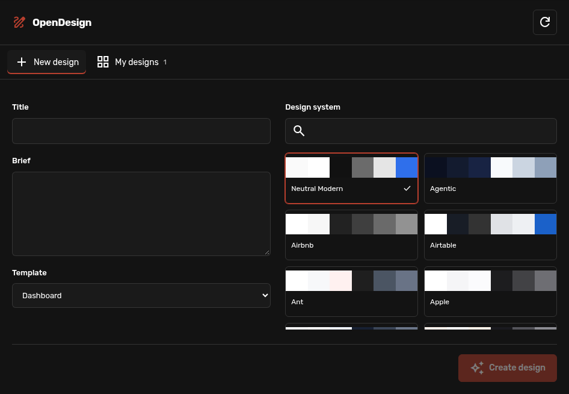

# OpenDesign for Agent Zero

Design systems, templates, interactive previews and HTML export in Agent Zero.

Open **OpenDesign** from the right canvas rail. Choose a template and design system, enter a title and brief, and select **Create design**. Agent Zero creates the design in a new chat using your selected model. Saved results appear under **My designs**; select **Refresh** after the agent saves a revision.



## Installation

In Agent Zero, open **Plugins → Install from Git** and enter:

```text
https://github.com/3clyp50/a0-open-design
```

Requires an Agent Zero version with community plugins, native canvas surfaces and Material `x-icon` support, Python 3.12+, Git, and outbound HTTPS to GitHub during installation. The install hook downloads a pinned OpenDesign library automatically. It installs no Python or Node packages and starts no background services. Repeated installation at the same revision reuses the library.

## Included

- Browse 152 upstream design systems with their actual palette colors.
- Choose from 115 upstream design templates; agents can also read 169 upstream skills.
- Create, inspect and revise designs through the native `open_design` agent tool.
- Preview interactive HTML at desktop or mobile width in a docked or floating panel.
- Download standalone HTML. Each save preserves the previous artifact as a separate file.
- Use your active Agent Zero model and provider. Their normal inference charges apply; the plugin adds no model account or API key.

This integration uses [OpenDesign](https://github.com/nexu-io/open-design)'s design resources with Agent Zero as the generating agent. The upstream desktop application, collaborative cloud service and coding-agent daemon are not installed.

## Agent tool

`open_design` supports `status`, `catalog`, `read`, `create`, `project`, and `save`. Catalog collections are `systems`, `templates`, and `skills`. Read the selected instructions before generating. `save` accepts a project ID and complete HTML, up to 2 MB.

```json
{"tool_name":"open_design","tool_args":{"action":"catalog","collection":"systems","query":"minimal"}}
```

## Preview boundaries

Generated HTML runs with an opaque origin, both iframe sandboxing and an HTTP Content Security Policy. Inline CSS/JavaScript, embedded images and HTTPS images work. External scripts/styles/fonts, network requests, parent-page access, form submissions and popups are blocked. Use embedded assets and system fonts for portable exports. HTTPS images can contact their image host; do not put secrets in generated documents. Downloaded HTML runs according to the environment where you open it, outside the A0 preview sandbox.

The preview and download endpoints retain A0 authentication. Read-only GET endpoints do not require CSRF tokens; every mutation uses A0's normal authenticated, CSRF-protected API.

## Storage and removal

- Downloaded upstream resources: `usr/plugins/open_design/_runtime/library/`.
- Designs and immutable HTML revisions: `usr/workdir/open_design/<project-id>/`.
- Briefs are saved locally and sent to your configured model when you start the design chat.

Disable through **Plugins** to hide the panel and tool. Uninstall removes plugin-owned resources and code. Designs remain in `usr/workdir/open_design/`; remove them separately only when no longer needed. No external process or shared dependency is changed.

## Development

Install this repository at `usr/plugins/open_design/` in an Agent Zero checkout. From that checkout, using its framework environment:

```bash
python -m pytest usr/plugins/open_design/tests -q
```

Tests cover project revisions, catalog parsing, input bounds, traversal/symlink rejection, authenticated previews and sandbox headers. UI verification includes the live A0 modal and canvas, narrow layouts, selection, export and native error notifications.

Upstream resource pin: `bc06128813c99fa63f5af53ad2c903c27db057f2` (OpenDesign 0.25.1). Catalog counts refer to that revision. Upstream resources retain their license and attribution in the downloaded checkout. This independent community integration is licensed under Apache-2.0; it is not an official Nexu product.
